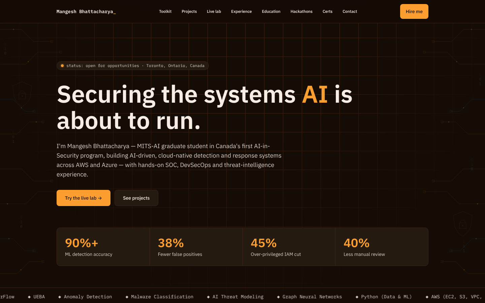

<div align="center">


# Mangesh Bhattacharya

### Cybersecurity Engineer · AI Threat Detection

**Securing the systems AI is about to run.**

[](https://mangesh-bhattacharya.github.io)

[](https://www.linkedin.com/in/mangesh-bhattacharya)
[](https://github.com/Mangesh-Bhattacharya)
[](https://tryhackme.com/p/TheOrbiter)
[](mailto:mangesh.bhattacharya@ontariotechu.net)
[](https://github.com/Mangesh-Bhattacharya/Mangesh-Bhattacharya.github.io/actions/workflows/deploy.yml)

<br />

<a href="https://mangesh-bhattacharya.github.io">
  
</a>

</div>

---

## About

MITS-AI graduate student in Canada's first AI-in-Security program (Ontario Tech University), building **AI-driven, cloud-native detection and response systems** across AWS and Azure, with hands-on SOC, DevSecOps and threat-intelligence experience.

| Metric | Result |
| :-- | :-- |
| ML detection accuracy | **90%+** |
| SOC false positives reduced | **38%** |
| Over-privileged IAM roles cut | **45%** |
| Manual review effort reduced | **40%** |

## What's on the site

| Section | Highlights |
| :-- | :-- |
| **[Toolkit](https://mangesh-bhattacharya.github.io/#toolkit)** | AI threat detection, cloud & DevSecOps, offensive security, frameworks |
| **[Projects](https://mangesh-bhattacharya.github.io/#projects)** | ML-based IDS, GNN network intrusion detection, malware classification, IoT botnet detection, cloud privilege-escalation defense |
| **[Live Lab](https://mangesh-bhattacharya.github.io/#lab)** | Interactive security terminal and an LLM prompt-injection firewall demo, running in the browser |
| **[Experience](https://mangesh-bhattacharya.github.io/#experience)** | Cybersecurity observability & AI, DevSecOps, data security |
| **[Education](https://mangesh-bhattacharya.github.io/#education)** | Ontario Tech University (MITS-AI) · Seneca Polytechnic · Humber Polytechnic |
| **[Hackathons](https://mangesh-bhattacharya.github.io/#thm)** | TryHackMe paths: Security Engineer, Red Teaming, Offensive Pentesting, DevSecOps |
| **[Certifications](https://mangesh-bhattacharya.github.io/#certs)** | CEH, CCSK, IBM AI Engineering, Azure Fundamentals, CCNA, ISC2 |
| **[Contact](https://mangesh-bhattacharya.github.io/#contact)** | Open to cybersecurity, AI-security and cloud-security roles |

## Featured projects

- **ML-Based Intrusion Detection System**: real-time anomaly detection at 90%+ accuracy using heuristics, supervised ML and UEBA.
- **Network Intrusion Detection with Graph Features**: GCN, GraphSAGE and GAT benchmarked against RF/XGBoost on CIC-IDS-2017.
- **AI-Powered Malware Classifier**: SOAR-integrated pipeline delivering 35% faster detection.
- **AWS & Azure Privilege-Escalation Defense**: Zero-Trust IAM and segmentation aligned to NIST and CIS.

See all projects, with live GitHub activity, on the **[portfolio](https://mangesh-bhattacharya.github.io/#projects)**.

## Tech stack


The site is fully prerendered to static HTML at build time and deployed to GitHub Pages by GitHub Actions. There's no server runtime, no tracking, and no third-party scripts beyond Google Fonts.

## Run locally

```bash
git clone https://github.com/Mangesh-Bhattacharya/Mangesh-Bhattacharya.github.io.git
cd Mangesh-Bhattacharya.github.io
bun install        # or: npm install
bun run dev        # http://localhost:8080
bun run build      # static output in dist/client
```

Portfolio content lives in [`src/data/profile.ts`](src/data/profile.ts). Edit it and push to `main` to redeploy automatically.

---

<div align="center">

**[View the live portfolio →](https://mangesh-bhattacharya.github.io)**

<sub>© Mangesh Bhattacharya · Toronto, Ontario, Canada</sub>

</div>
